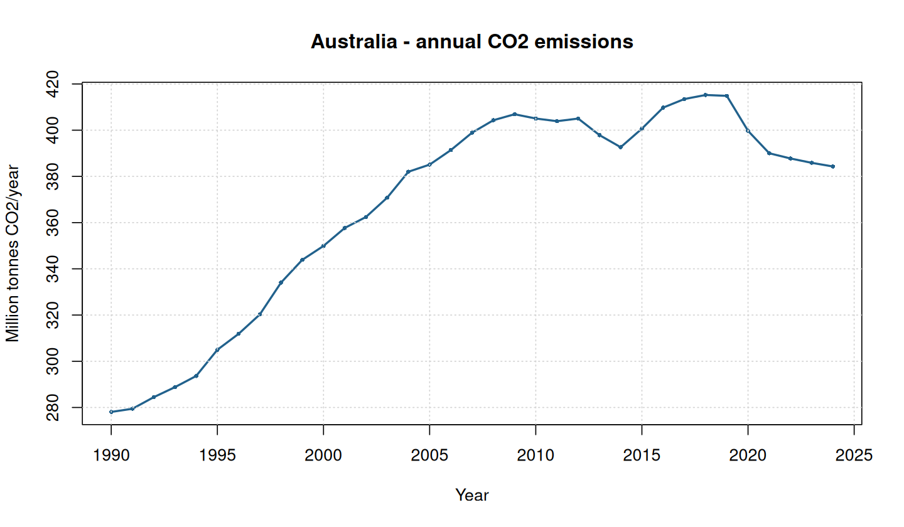
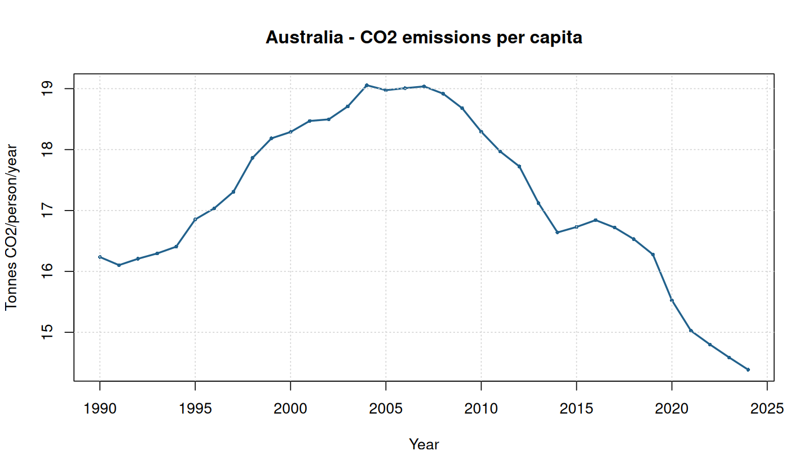
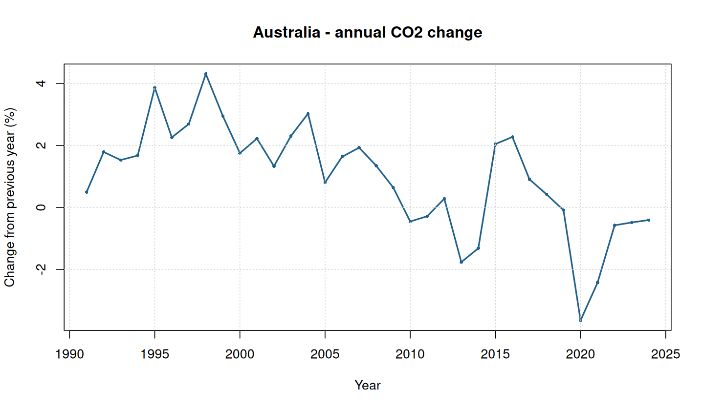

# Country-Level CO₂ Emissions: Australia (AUS)

Student Name: Jenie D. Benedico

## Introduction

This project examines the carbon dioxide (CO₂) emission trends of Australia from 1990 to 2024 using data from Our World in Data.

The objectives of this analysis are to:

- Examine changes in Australia's annual CO₂ emissions.
- Analyze changes in CO₂ emissions per capita.
- Identify yearly increases and decreases in CO₂ emissions.
- Describe the overall emission trends throughout the study period.

**Country:** Australia  
**ISO-3 Code:** AUS  
**Study Period:** 1990–2024

## Results

The following figures show the results of the analysis of Australia's CO₂ emissions from 1990 to 2024.

### Figure 1. Annual CO₂ Emissions in Australia (1990–2024)

### Figure 2. CO₂ Emissions per Capita in Australia (1990–2024)

### Figure 3. Annual Change in CO₂ Emissions in Australia (1990–2024)

## Interpretation
Collectively, the three figures provide a comprehensive overview of Australia’s carbon dioxide emissions trajectory from 1990 to 2024, examining per capita output, 
total annual volume, and year-over-year percentage fluctuations. Across all three metrics, Australia’s emissions profile transitions from rapid expansion during the 
1990s and early 2000s to a period of structural stabilization, followed by a pronounced downward shift after 2019—reflecting a broader trend observed across several 
industrialized economies that achieved significant fossil reductions over the past decade (Friedlingstein et al., 2024).

Figure 1 illustrates Australia’s emissions per capita, measured in tonnes of person per year. Starting at approximately 16.2 tonnes in 1990, individual emissions 
dipped slightly in 1991 before climbing steadily throughout the decade. Per capita emissions plateaued at a peak of roughly 19.0 tonnes per person between 2004 and 
2007. Following 2007, individual carbon output entered a long-term downward trend, dropping sharply to about 16.6 tonnes in 2014. After a minor uptick to 16.8 tonnes 
in 2016, per capita emissions fell precipitously—accelerating after 2019—to reach a 34-year low of approximately 14.4 tonnes per person by 2024.

Figure 2 details Australia’s total annual emissions in million tonnes per year, highlighting the divergence between population-adjusted and aggregate national emissions. 
In 1990, total emissions stood just below 280 million tonnes. Driven by sustained economic and demographic expansion, aggregate emissions rose uninterruptedly for nearly 
two decades, surpassing 400 million tonnes by 2008 and reaching an initial peak of roughly 407 million tonnes in 2009. Between 2010 and 2014, total output dipped slightly
to around 393 million tonnes before rebounding to an all-time high of approximately 415 million tonnes in 2018 and 2019. Notably, even while per capita emissions were 
declining between 2007 and 2018, total national emissions remained elevated because rapid population growth offset individual efficiency gains. After 2019, aggregate emissions
dropped sharply to 390 million tonnes in 2021 and continued a gradual decline to roughly 384 million tonnes in 2024. 

Figure 3 contextualizes these absolute trends by displaying the annual percentage change in emissions relative to the preceding year. From 1991 to 2009, every data point 
remained above the 0% threshold, reflecting unbroken annual growth that peaked at over +4.2% in 1998. Between 2010 and 2014, growth rates entered negative territory for the
first time—reaching nearly -1.8% in 2013—before briefly rebounding to over +2% in 2015 and 2016. The sharpest contraction occurred in 2020, when emissions fell by approximately
-3.7%, coinciding with global COVID-19 pandemic disruptions to transport and economic activity (Friedlingstein et al., 2024). Crucially, rather than bouncing back into positive
growth, the annual rate of change remained consistently negative between -0.4% and -0.6% from 2022 through 2024.

Together, the three figures demonstrate that Australia has moved past its peak emissions era. While historical population expansion kept aggregate emissions high even as per 
capita intensity improved, sustained negative annual growth rates since 2020 have finally driven both total and per capita emissions onto a consistent downward path (Friedlingstein et al., 2024).

## Limitations

This study has several limitations:

- **Geographical coverage:** The analysis focuses only on Australia, so the findings cannot represent the CO₂ emission trends of other countries.
- **Study period:** The analysis covers only 1990–2024 and does not include years outside this period.
- **Missing data:** Some observations in the original dataset may be unavailable or incomplete, which may affect the analysis.
- **Emission coverage:** The selected CO₂ emissions data cover fossil fuels and industrial processes but exclude emissions from land-use change and forestry.
- **Descriptive analysis:** The study describes emission patterns and changes but does not establish the specific causes behind them.

## References

Our World in Data. (n.d.). *CO₂ and Greenhouse Gas Emissions*.  
https://ourworldindata.org/co2-and-greenhouse-gas-emissions

Our World in Data. (n.d.). *CO₂ and Greenhouse Gas Emissions Dataset*.  
https://owid-public.owid.io/data/co2/owid-co2-data.csv

Friedlingstein, P., O'Sullivan, M., Jones, M. W., Andrew, R. M., Hauck, 
J., Landschützer, P., Le Quéré, C., Li, H., Luijkx, I. T., Olsen, A., Peters, 
G. P., Peters, W., Pongratz, J., Schwingshackl, C., Sitch, S., Canadell, J. G.,
Ciais, P., Jackson, R. B., Alin, S. R., … Berghoff, C. F. (2024). Global Carbon
Budget 2024. Copernicus GmbH. 
https://doi.org/10.5194/essd-2024-519

- `README.md` – Project description, results, interpretation, and references.

